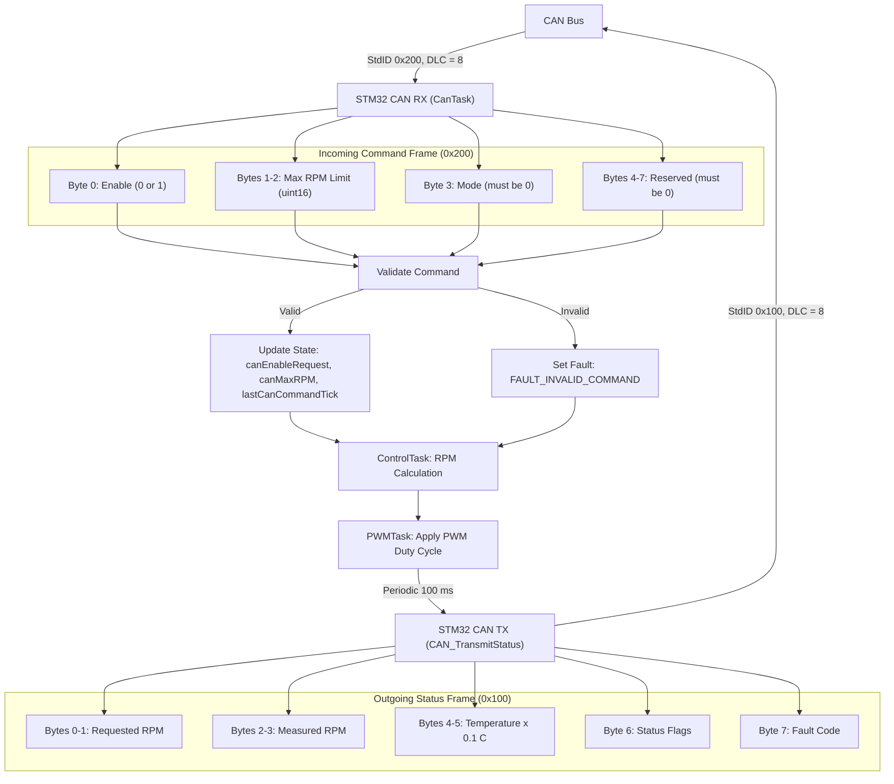

# EV Motor Control – Completed Version (EV_motor_control_CAN1)

This folder contains the **completed and production‑ready version** of the EV Motor Control project.  
It expands the original design with a full FreeRTOS architecture, CAN command handling, ADC‑based pedal and temperature sensing, PWM motor control, and UART diagnostics.

This version lives in a different directory and project name and is added to the repository as a **separate branch** to preserve workflow history.

---

## 🚗 Project Overview

This project implements a complete STM32‑based EV motor control system using:

- **STM32 Nucleo‑F446RE**
- **CAN1 peripheral** with SN65HVD230 transceiver
- **FreeRTOS** for deterministic task scheduling
- **ADC1** for pedal and temperature sensing
- **TIM3 PWM** for motor speed control
- **UART2** for runtime diagnostics
- **Safety logic** for CAN timeout, invalid commands, and over‑temperature

The system receives commands over CAN (ID **0x200**) and publishes status frames (ID **0x100**) at a fixed period.

---

## 🧩 System Architecture

### FreeRTOS Tasks

| Task Name          | Purpose |
|--------------------|-------------------------------------------------------------|
| **PedalTask**      | Reads ADC Channel 0 → pedal percentage (0–100%). |
| **TemperatureTask**| Reads ADC Channel 1 → temperature (scaled to °C). |
| **ControlTask**    | Core logic: safety checks, RPM calculation, UART debug. |
| **PWMTask**        | Converts desired RPM → TIM3 PWM duty cycle. |
| **CanTask**        | Receives CAN commands, validates frames, updates state. |
| **DefaultTask**    | Idle task. |

---

## ⏱ FreeRTOS Task Timing Diagram

```mermaid
gantt
    dateFormat  X
    axisFormat  %L
    title EV Motor Control – FreeRTOS Task Timing Diagram

    section PedalTask (10 ms)
    ADC Channel 0 Read        :active, 0, 10
    ADC Channel 0 Read        :active, 10, 20
    ADC Channel 0 Read        :active, 20, 30
    ADC Channel 0 Read        :active, 30, 40
    ADC Channel 0 Read        :active, 40, 50
    ADC Channel 0 Read        :active, 50, 60
    ADC Channel 0 Read        :active, 60, 70
    ADC Channel 0 Read        :active, 70, 80
    ADC Channel 0 Read        :active, 80, 90
    ADC Channel 0 Read        :active, 90, 100

    section TemperatureTask (100 ms)
    ADC Channel 1 Read        :active, 0, 100

    section ControlTask (20 ms)
    Control Logic             :active, 0, 20
    Control Logic             :active, 20, 40
    Control Logic             :active, 40, 60
    Control Logic             :active, 60, 80
    Control Logic             :active, 80, 100

    section CanTask
    CAN RX Polling (continuous) :crit, 0, 100
    Status TX (100 ms)          :milestone, 100, 0

    section PWMTask (event-driven)
    Apply PWM on new RPM        :done, 5, 0

```

## 📡 CAN Protocol

### Incoming Command Frame (StdID = 0x200, DLC = 8)

| Byte | Meaning                          |
|------|----------------------------------|
| 0    | Enable (0 or 1)                  |
| 1–2  | Max RPM limit (uint16)           |
| 3    | Mode (must be 0)                 |
| 4–7  | Reserved (must be 0)             |

Invalid frames trigger:

- `FAULT_INVALID_COMMAND`
- `canEnableRequest = 0`
- `canMaxRPM = 0`

### Outgoing Status Frame (StdID = 0x100, DLC = 8)

| Byte | Meaning                                  |
|------|------------------------------------------|
| 0–1  | Requested RPM                            |
| 2–3  | Measured RPM (0xFFFF placeholder)        |
| 4–5  | Temperature × 0.1°C                      |
| 6    | Status flags                             |
| 7    | Fault code                               |

## 📡 CAN Protocol Diagram

##⚙️ Motor Control Logic Flowchart

flowchart TD

    A[PedalTask pedalPercent] --> C
    B[TemperatureTask temperatureC] --> C
    X[CanTask enable, maxRPM, lastCommandTick, faultCode] --> C

    C[ControlTask 20 ms loop] --> D{Over‑temperature?}
    D -->|Yes| F[Set Fault = OVERTEMPERATURE Disable Motor]
    D -->|No| E{CAN Timeout or No Command?}

    E -->|Yes| G[Set Fault = CAN_TIMEOUT Disable Motor]
    E -->|No| H{Command Valid?}

    H -->|No| I[Set Fault = INVALID_COMMAND Disable Motor]
    H -->|Yes| J[Compute pedalRPM = pedalPercent × MAX_RPM]

    J --> K[Clamp pedalRPM to CAN maxRPM]
    K --> L[finalRPM = pedalRPM if enabled]

    L --> M[Update requestedRPMStatus]
    M --> N[Reset MotorCommandQueue]
    N --> O[Send desiredSpeedRPM to PWMTask]

    O --> P[PWMTask Apply PWM Duty Cycle]
    P --> Q{timingPending?}
    Q -->|Yes| R[Compute CAN→PWM latency UART print]
    Q -->|No| S[Continue]

    P --> T[CAN_TransmitStatus every 100 ms]

## 🧪 Testing Workflow

1. Power the Nucleo‑F446RE and the SN65HVD230 CAN transceiver.
2. Ensure the CAN bus is properly terminated with a 120Ω resistor.
3. Connect the **Jhoinrch CAN interface** between the STM32 board and your PC.
4. Use **Cangaroo** software on the PC to send and monitor CAN frames:
   - Transmit command frames (StdID = 0x200, DLC = 8)
   - Observe status frames (StdID = 0x100, DLC = 8)
5. Open a serial terminal at **115200 baud** to view UART diagnostics from USART2.
6. Verify PWM output on **TIM3 Channel 1** using a **logic analyzer**:
   - Confirm duty cycle changes with pedal input
   - Confirm RPM clamping based on CAN maxRPM
7. Monitor pedal ADC readings (Channel 0) and temperature ADC readings (Channel 1) to confirm correct scaling.
8. Validate safety features:
   - CAN timeout (500 ms)
   - Over‑temperature shutdown (≥ 90°C)
   - Invalid command rejection
9. Confirm periodic CAN status frames (StdID = 0x100, DLC = 8) are transmitted every 100 ms.

## 📈 Performance & Test Results

- Successfully tested **30,000+ CAN frames** using the Jhoinrch CAN interface and Cangaroo software with **zero observed errors**.
- Measured **CAN‑command‑to‑control‑task response latency** between **4–14 ms**, depending on system load and task scheduling.
- Verified PWM output timing and duty‑cycle accuracy using a **logic analyzer** connected to TIM3 Channel 1.
- Confirmed stable FreeRTOS task execution:
  - PedalTask at 10 ms
  - ControlTask at 20 ms
  - TemperatureTask at 100 ms
  - CAN status transmission every 100 ms
- No missed dealines or queue overflows observed during extended testing.

## 📁 Repository Structure

EV_motor_control/
│
├── EV_motor_control_CAN1/        ← Completed project (this branch)
│   ├── Core/
│   ├── Drivers/
│   ├── Middlewares/
│   ├── STM32CubeIDE/
│   ├── Inc/
│   ├── Src/
│   ├── .gitignore
│   ├── .project
│   ├── .cproject
│   ├── README.md
│   └── (STM32CubeIDE generated files)
│
└── (Original project stored in main/master branch)

